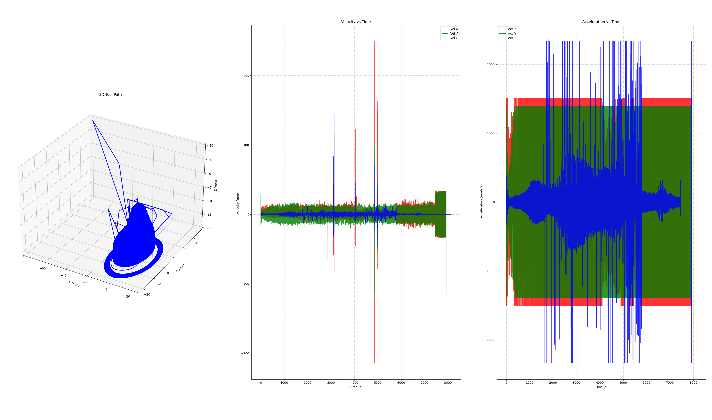
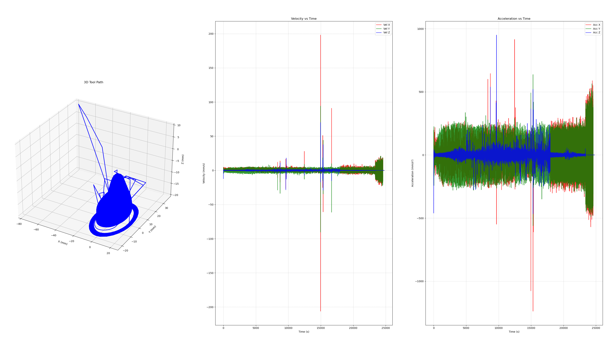

# 5-axis CNC Machine Trajectory Generator

This project focuses on extracting positions from a GCode file, interpolating the positions using an S-curve trajectory for a 5-axis CNC machine and getting the forward and inverse kinematics governed by the given machine parameters.

---

## Machine Parameters

| Axis | Type | Position Range | Max. Velocity | Max. Acceleration |
| --- | --- | --- | --- | --- |
| **X** | Linear (mm) | -150 to +150 mm | 250 mm/s | 1510 mm/s² |
| **Y** | Linear (mm) | -180 to +180 mm | 500 mm/s | 1390 mm/s² |
| **Z** | Linear (mm) | -180 to 0 mm | 250 mm/s | 2340 mm/s² |
| **A** | Rotary (°) | -110° to +110° | 461 °/s | 9220 °/s² |
| **C** | Rotary (°) | -1e99° to 1e99° | 720 °/s | 7200 °/s² |

---

## Requirements

- Ubuntu 24.04
- Docker

## Environment Setup

```bash
# Setup the docker container for running the project

docker compose --profile cpu up --build -d # CPU version for non-GPU systems
docker compose --profile gpu up --build -d # GPU version for NVIDIA systems with nvidia-container-toolkit set up

docker exec -it em-trajectory bash
```

---

## Inverse Kinematics

Inverse Kinematics (IK) calculates the physical machine coordinates $\mathbf{M} = [X_m, Y_m, Z_m]^T$ required to position the tool tip at a specific part coordinate $\mathbf{P}_w = [X, Y, Z]^T$ given rotary commands $A$ and $C$.

The transformation relies on two structural offset vectors:

1. **Pivot Offset:** The distance along the Z-axis from the A-axis center of rotation to the C-axis platter face.
2. **Setup Offset:** Height of the workpiece origin above the platter.

The rotation matrices for the C-axis (around Z) and A-axis (around X) are defined as:

$$R_c(C) = \begin{bmatrix} \cos C & -\sin C & 0 \\ \sin C & \cos C & 0 \\ 0 & 0 & 1 \end{bmatrix}, \quad R_a(A) = \begin{bmatrix} 1 & 0 & 0 \\ 0 & \cos A & -\sin A \\ 0 & \sin A & \cos A \end{bmatrix}$$

To find the machine position, the part coordinates are rotated by the C-axis, translated by the pivot offset, rotated by the A-axis trunnion, and then translated back before the static work offset is applied:

$$\mathbf{M} = R_a(A) \cdot (R_c(C) \cdot \mathbf{P}_w + \mathbf{D}) - \mathbf{D}$$

## Forward Kinematics

Forward Kinematics (FK) performs the exact mathematical inverse. It is used by the CNC controller to report the current tool-tip position relative to the workpiece based on the real-time encoder feedback of the physical motors.

Given the physical machine coordinates $\mathbf{M}$, we isolate the part coordinates $\mathbf{P}_w$ by reversing the operational order and negating the angles to apply inverse rotation matrices $R_a(-A)$ and $R_c(-C)$:

$$\mathbf{P}_w = R_c(-C) \cdot \left( R_a(-A) \cdot (\mathbf{M} + \mathbf{D}) - \mathbf{D} \right)$$

---

## Trajectory Generator

Run the trajectory generator with the `.tap` file provided.
The output will be in form of a `.csv` file for viewing the generated trajectory in a human-readable form.
```bash
./em-trajectory-generator <path_to_gcode.tap>
```

***Note:*** *The IK check should only be enabled once offsets are known correctly.*

---

## Trajectory Visualizer

Run the trajectory visualizer with the `.csv` file containing the trajectory provided.
```bash
./em-trajectory-visualizer <path_to_trajectory.csv>
```

---

## Trajectory Comparison

<div style="text-align: center;">
    <figure style="display: inline-block; vertical-align: top; margin-right: 20px;">
        
        <figcaption><em>Trapezoidal Trajectory</em></figcaption>
    </figure>
    <figure style="display: inline-block; vertical-align: top;">
        
        <figcaption><em>S-Curve Trajectory</em></figcaption>
    </figure>
</div>

---